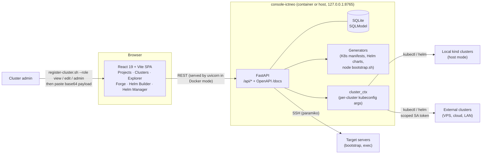

# console-ictneo: Kubernetes command console

[](https://github.com/GhislainAdon/console-ictneo/actions/workflows/ci.yml)


[](LICENSE)

> A self-hosted **FastAPI + React** dashboard to run several Kubernetes projects from one place: declare target servers, spin up local `kind` clusters or onboard any remote cluster with a scoped ServiceAccount, manage namespaces, install Helm charts from any repo, generate manifests and Helm charts, explore live resources, and exec into pods or servers.

[Résumé en français](#résumé-en-français) · [Detailed usage guide](docs/USAGE.md) · [Architecture review (FR)](docs/ANALYSE.fr.md)

---

## The problem

A DevOps engineer working on several client or lab projects ends up juggling `kind` clusters, remote clusters behind different kubeconfigs, Helm repos, values files and SSH sessions to nodes. Each project has its own Kubernetes version, cert provider, domain and add-on set. Lens/Freelens are great at *viewing* clusters, but they do not model **projects** (nodes + cluster + releases + generated artefacts) and do not help **bootstrap** them.

console-ictneo groups everything per project. A project has a K8s version, cert provider, domain, add-on matrix, target nodes, an attached cluster and Helm releases. The console drives `kind`, `kubectl`, `helm` and SSH for you.

## Architecture



## Features

- **Projects**: K8s version (1.31–1.35), cert provider (Let's Encrypt / Cloudflare origin CA), domain, a matrix of ~16 add-ons, target nodes and Helm releases.
- **Target nodes**: SSH via agent, key or password, a generated per-node `bootstrap.sh`, and remote command exec.
- **Clusters**: one-click **`kind`** provisioning (host mode) or **external cluster onboarding**. The cluster admin runs [`scripts/register-cluster.sh`](scripts/register-cluster.sh) with `--role view|edit|admin`. It creates a dedicated ServiceAccount + ClusterRoleBinding and returns a base64 payload. Access is revoked by deleting the SA.
- **Namespaces**: list, create and delete, with RFC 1123 validation and system namespaces protected.
- **Resource Explorer**: 16 kinds, YAML describe, scale ±1, delete, one-shot pod exec.
- **Resource Forge**: form-based generation of raw manifests for 15 kinds.
- **Helm Builder**: generates a full chart from scratch (deployment, service, ingress, HPA, SA, ConfigMap, `values-{dev,test,prod}.yaml`) and downloads it as a zip.
- **Helm Manager**: add any repo, load chart default values, edit overrides, idempotent `helm upgrade --install`, uninstall. Releases are tracked as `draft → deployed → uninstalled/failed`.
- **Two runtime modes**: *Host* (full features incl. `kind`) or *Docker* (single non-root container with `kubectl` + `helm` baked in, for piloting remote clusters).

## Quickstart

**Docker mode** (pilot remote clusters; only Docker needed):

```bash
git clone https://github.com/GhislainAdon/console-ictneo.git && cd console-ictneo
./deploy.sh                 # or: docker compose up -d --build
# -> http://127.0.0.1:8765  (API docs at /docs)
```

**Host mode** (also provisions local `kind` clusters; needs Python 3.10+, Node 18+, kind, kubectl, helm):

```bash
./start.sh
# backend  -> http://127.0.0.1:8765
# frontend -> http://127.0.0.1:5173
```

**Onboard an existing cluster**: on the Clusters page click *+ Register External*, then have a cluster admin run:

```bash
bash scripts/register-cluster.sh --role view     # or edit / admin
```

Paste the printed payload into the drawer. See the [usage guide](docs/USAGE.md) for every screen, the API reference and the Docker Desktop networking caveats.

## Screenshots

> _Placeholders, to be added (see [docs/screenshots](docs/screenshots/))._

| Overview | Projects & nodes | Resource Explorer | Helm Manager |
|---|---|---|---|
| `docs/screenshots/overview.png` | `docs/screenshots/projects.png` | `docs/screenshots/explorer.png` | `docs/screenshots/helm-manager.png` |

## Tech stack

- **Backend**: Python 3.12, FastAPI, SQLModel/SQLite, Pydantic v2, Jinja2 templates, Paramiko (SSH), `kubectl` / `helm` / `kind` driven via subprocess
- **Frontend**: React 19, TypeScript, Vite, React Router, Zustand, Framer Motion
- **Packaging**: multi-stage Dockerfile (Node 22 build → `python:3.12-slim`, non-root UID 10001), docker compose bound to localhost
- **CI**: GitHub Actions with ruff, a backend import smoke test, `npm ci` + type-checked Vite build, ShellCheck, Docker build and a Trivy image scan

## Security notes

- Built as a **local operator tool**. It binds to `127.0.0.1` and has **no authentication yet**. Put an authenticating proxy in front (OIDC, Teleport App Access) before exposing it.
- SSH passwords for target nodes are stored **in clear text** in SQLite. Prefer `agent` or `key` auth.
- External clusters are accessed with a **scoped ServiceAccount token** (view by default), stored in `data/kubeconfigs/*.yaml` with mode `0600`.

## Roadmap

- [ ] Authentication (OIDC middleware) and per-user audit log for exec / delete actions
- [ ] Encrypt stored secrets (age / SOPS or OS keyring) instead of clear-text SSH passwords
- [ ] Backend test suite (pytest + FastAPI TestClient) and ESLint gate in CI
- [ ] Alembic migrations, optional PostgreSQL for multi-user setups
- [ ] Live log streaming (`kubectl logs -f`) over WebSocket/SSE
- [ ] Publish the image to GHCR with SBOM and signature (cosign)

---

## Résumé en français

**console-ictneo** est une console Kubernetes auto-hébergée (**FastAPI + React**) organisée **par projet**. Chaque projet regroupe sa version K8s, son domaine, ses add-ons, ses serveurs cibles, son cluster et ses releases Helm. La console permet :

- de créer des clusters `kind` en local ;
- d'enrôler n'importe quel cluster distant via un ServiceAccount à droits limités (`register-cluster.sh --role view|edit|admin`) ;
- de gérer les namespaces ;
- d'explorer les ressources (describe, scale, delete, exec) ;
- de générer des manifestes et des charts Helm complets ;
- d'installer des charts depuis n'importe quel dépôt (`helm upgrade --install` idempotent).

Elle tourne en mode hôte (complet) ou en conteneur non-root. Une analyse d'architecture détaillée est disponible : [docs/ANALYSE.fr.md](docs/ANALYSE.fr.md).

## License

[MIT](LICENSE) © Ghislain Adon
